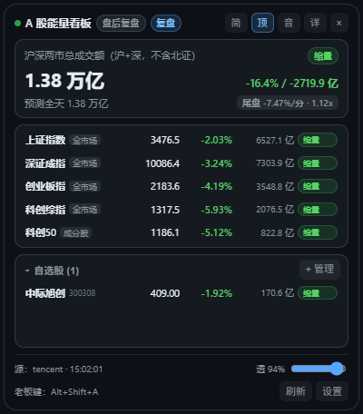
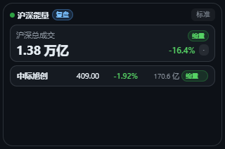
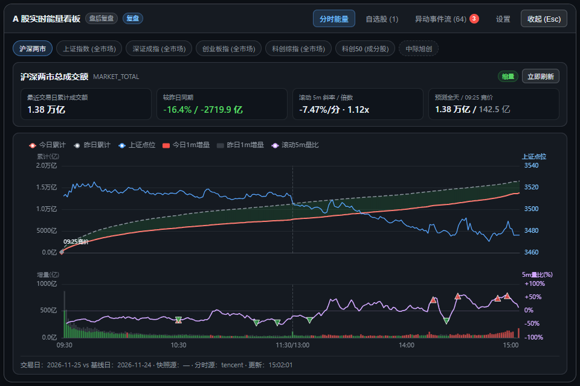
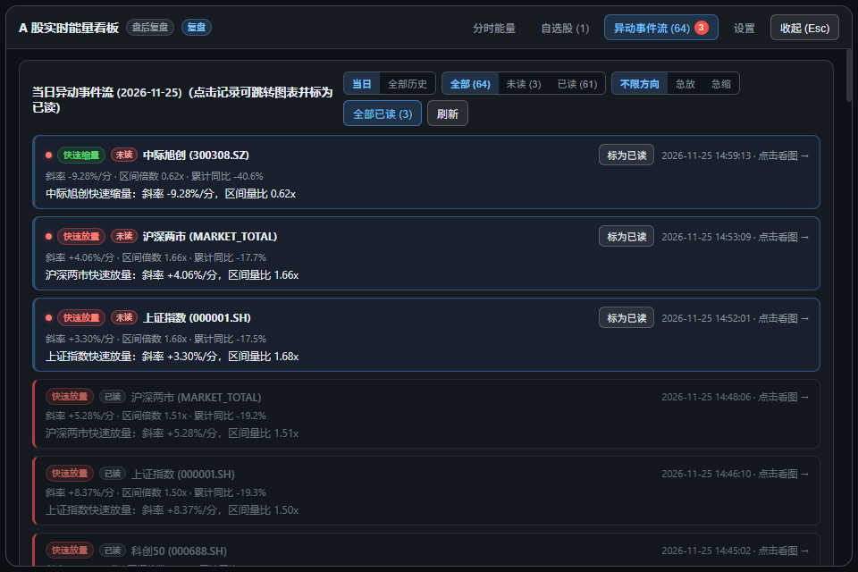
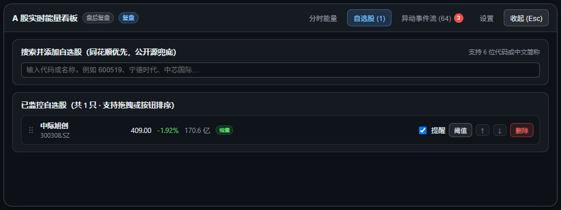
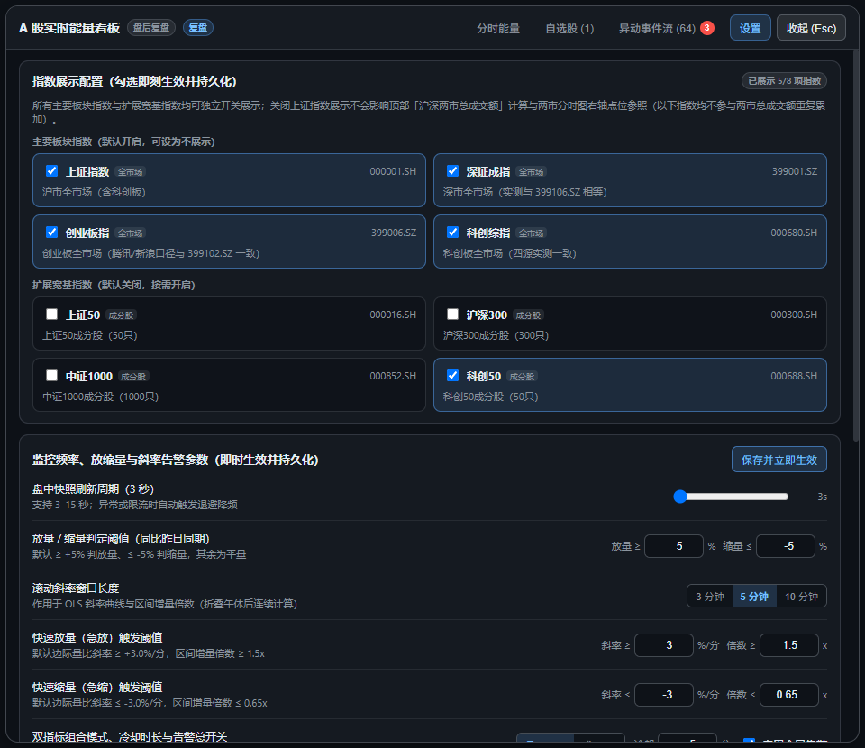

# A 股实时能量看板（ashare-volpulse）

一款专为 A 股盘中看盘打造的 **Windows / macOS 桌面端实时量能监控看板**。采用「**紧凑悬浮窗 HUD + 可展开详情浮层 + 系统托盘**」形态（无独立浏览器网页），实时追踪沪深两市总成交额、核心宽基指数及自选股/场内基金的放缩量与资金异动趋势。

---

## 核心亮点

- **双态桌面悬浮窗**：暗色半透明、置顶不占任务栏、严格 **红涨绿跌**。标准模式支持四边/四角自由缩放与透明度调节；一键切入极简模式，仅保留「沪深总成交 + 前 3 条自选股」。支持系统托盘控制与全局老板键一键显隐。
- **真实两市量能与午休折叠双图**：沪深总成交额严格按「沪市全市场 + 深市全市场」统计（不含北证，不重复累加），自动折叠 `11:30–13:00` 午休并单标 `09:25` 集合竞价，直观对比今昨累计成交额、1 分钟增量柱、全天预测成交额与滚动量比斜率。
- **自选股与场内 ETF/LOF 监控**：支持按代码或中文名搜索添加个股、指数及场内基金（ETF/LOF 精确保留 3 位小数），拖拽排序、单股开关与自定义提醒阈值，点击任意行直达对应图表。
- **多通道急放 / 急缩提醒**：盘中突发急放量或急缩量时，同步触发悬浮窗呼吸高亮、系统原生通知、可静音区分提示音与异动事件流（支持已读/未读筛选、一键全部已读及点击定位图表）。
- **独立复盘回放控制台**：内置于详情浮层「复盘回放」页签，支持回看近 30 个交易日（新下载开箱即含近 5 日分时数据）。选中交易日后默认立即可见全天急放/急缩三角标记与异动流，支持从头播放、暂停、倍速调节、时间轴拖拽定位、单步前后退及临时调参试跑并一键应用至实盘（回放全程不中断后台实盘监控）。

---

## 界面预览

| 紧凑悬浮窗 HUD（标准模式） | 紧凑悬浮窗 HUD（极简模式） |
| :---: | :---: |
|  |  |

| 分时能量双图联动 | 异动事件流（已读 / 未读） |
| :---: | :---: |
|  |  |

| 自选股与阈值管理 | 指数展示与参数设置 |
| :---: | :---: |
|  |  |

---

## 下载与使用

### 1. 获取客户端
前往仓库 **Releases** 页面下载对应平台安装包：
- **Windows**：下载免安装便携版 `.zip`，解压后直接双击运行。
- **macOS**：下载 `.dmg`（支持 Apple Silicon 与 Intel），拖入「应用程序」后运行。
  > 若首次打开提示「无法验证开发者」或「已损坏」，可在终端执行 `xattr -cr "/Applications/A股能量看板.app"` 后重新打开，或在「系统设置 → 隐私与安全性」中点击「仍要打开」。

### 2. 开箱即用（无需强制配置 API Key）
- 软件内置多路公开行情源，**下载后无需配置任何 API Key 即可完整使用**实时看板、分时双图、自选股搜索（含 ETF/LOF）、盘中告警及复盘回放全部功能。
- 若已持有 [同花顺 Fuyao](https://fuyao.aicubes.cn/admin) API Key，可在「设置」页中选填（通过系统加密保存），用于获取更权威的年度交易日历并启用低频紧急兜底。

### 3. 常用快捷键

| 快捷键 | 作用域 | 说明 |
| --- | --- | --- |
| `Alt + Shift + A` | 全局（可在设置页改绑） | 老板键：一键隐藏 / 恢复所有窗口 |
| `Esc` | 详情浮层 | 收起详情浮层 |
| `Space` / `←` / `→` | 复盘回放页签 | 播放或暂停 / 后退 1 分钟 / 前进 1 分钟 |

---

## 更多文档与开源协议

- **技术架构、算法口径、数据源与本地开发打包**：请参阅 [技术架构与开发指南](docs/ARCHITECTURE.md)
- **版本更新记录**：请参阅 [CHANGELOG.md](CHANGELOG.md)
- **开源协议**：[MIT License](LICENSE)

> **免责声明**：本项目仅用于 A 股盘中成交额与量能变化的本地可视化监控与复盘研究，不构成任何投资建议，也不包含任何自动下单或交易执行功能。
